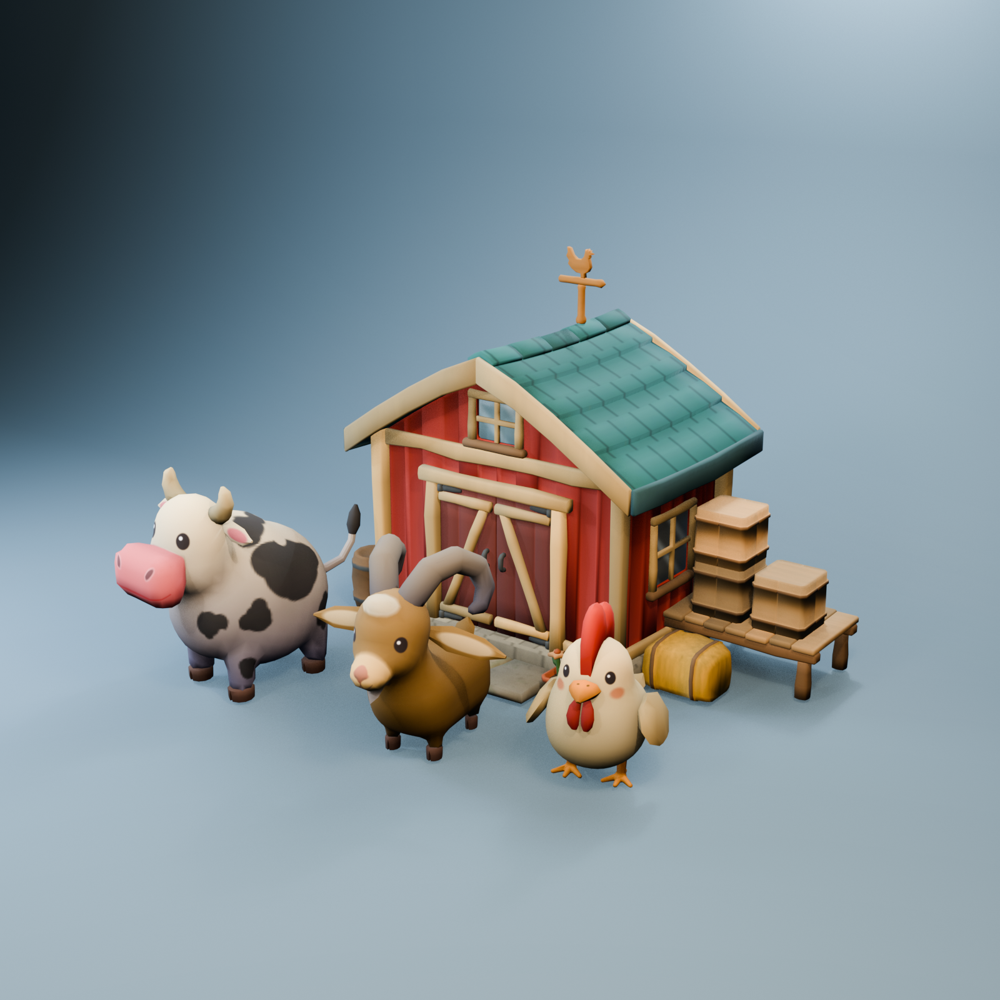
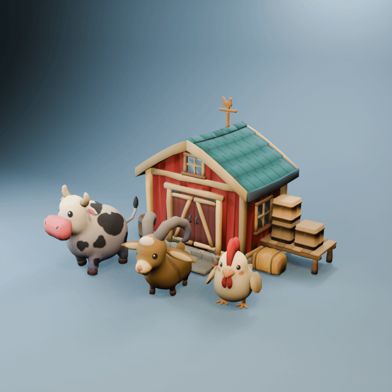

# Game 3D Modelling Skill

A provider-neutral Agent Skill for creating polished, game-ready 3D models with
Blender Python. It turns text, image references, or both into a reproducible
production pipeline covering modelling, materials, rigging, animation, review,
GLB export, and game-engine handoff.

Repository and installed skill name: `game-3d-modelling-skill`.

## Showcase





## What it helps an AI create

- stylized game props, buildings, creatures, characters, and articulated models;
- a measurable brief from a text prompt, image reference, or combined input;
- reproducible Blender geometry built through executable `bpy` helpers;
- UVs, deterministic textures, albedo/roughness maps, color-space-correct
  Principled materials, and clean GLB material links;
- rigid hierarchies or skinned armatures with validated weights;
- object, skeletal, and morph animation that can survive GLB export;
- runtime contracts for animated material values, emission, texture/atlas state,
  visibility, and effects when those channels are not portable in standard GLB;
- measurable geometry, topology, contact, grounding, and support checks;
- consistent multi-view review evidence and a clean-scene GLB re-import audit;
- an explicit handoff for collision, LOD, shaders, animation playback, and
  performance testing in the target game engine.

This is a production workflow, not a primitive-stacking prompt or a collection
of prototype screenshots. See [the quality bar](references/quality-bar.md) and
[the capability status](references/capability-status.md) for the exact acceptance
rules and the checks that still depend on a target engine.

## Install

Keep the complete repository together. `SKILL.md` loads its Python helpers,
templates, and references only when they are needed.

### Quick install: Claude Code, Codex, Cursor, and compatible agents

The cross-agent installer needs Node.js but no GitHub CLI:

```bash
npx skills add https://github.com/sunarya-thito/game-3d-modelling-skill --skill game-3d-modelling-skill
```

Run it from your game project. The installer detects supported agents and lets
you choose the destination and scope. See the
[skills CLI documentation](https://www.skills.sh/docs/cli) for scopes and
updates.

### Claude

- **Claude.ai:** download this repository as a ZIP, then open **Customize →
  Skills → + → Create skill → Upload a skill**. Upload the ZIP with the
  `game-3d-modelling-skill` folder at its root.
- **Claude Code:** use the quick-install command above, or copy the repository
  to `~/.claude/skills/game-3d-modelling-skill/` for personal use or
  `.claude/skills/game-3d-modelling-skill/` for one project.

Claude.ai skills can sync into supported Claude Code sessions. Current behavior
and account requirements are documented in
[Use skills in Claude](https://support.claude.com/en/articles/12512180-use-skills-in-claude)
and [Claude Code skills](https://code.claude.com/docs/en/skills).

### Gemini CLI

Gemini CLI has a native remote installer:

```bash
gemini skills install https://github.com/sunarya-thito/game-3d-modelling-skill
```

Add `--scope workspace` for the current project only. See
[Gemini CLI Agent Skills](https://geminicli.com/docs/cli/using-agent-skills/) for
linking, updating, enabling, and removing skills.

### Other AI clients

If the client supports custom-skill ZIP uploads, upload the complete repository.
Otherwise, copy, attach, or mount it and ask the AI to read `SKILL.md` before it
starts the 3D task. Keep `references/`, `scripts/`, `templates/`, and `examples/`
beside `SKILL.md`. The instructions use the open
[Agent Skills format](https://agentskills.io/home).

## Requirements

- An AI agent that can read the complete skill folder and run local commands.
- [Blender](https://www.blender.org/download/) **4.2.5 LTS**, the version used by
  the bundled regression suite. Other Blender versions should be tested before
  production use.
- A target game engine for final shader, collision, LOD, playback, and
  performance acceptance when those checks are part of the request.

Users do not need to memorize Blender's headless flags or the helper APIs. The
skill contains those operational instructions in
[the Blender headless guide](references/blender-headless.md) and
[the Blender Python authoring guide](references/bpy-authoring-guide.md), where
the AI can load them when required.

## Use it

Describe the model, provide references when available, and name the target game
constraints. For example:

```text
Use the game-3d-modelling-skill to create a stylized low-poly market cart for a
mobile game. Use the attached front and side references, keep it under 8,000
triangles, build a turning wheel rig, and show me the review views before final
export.
```

```text
Use the game-3d-modelling-skill to create and texture this creature from my
written description. Rig it, author a seamless walk cycle, export GLB, re-import
it for verification, and leave engine-only animation channels in a sidecar
manifest.
```

```text
Use the game-3d-modelling-skill to review this existing model. Do not edit it.
Run the measurable gates and prepare a visual-review handoff if you cannot
inspect images reliably.
```

The AI should return the brief, source builder, generated Blender/GLB outputs,
measured reports, review images, animation evidence, and a clear list of any
engine checks that remain pending.

## How the pipeline stays reliable

| Stage | Evidence before continuing |
|---|---|
| Reference intake | Observable text/image traits, uncertainties, rights, and measurable brief |
| Form | Deliberate silhouette, proportions, negative spaces, and contacts |
| Geometry gate | Bounds, origin, budgets, topology, winding, intersections, gaps, penetration, and support |
| Surface | UV density/stretch, gutters, generated or painted maps, color spaces, and material links |
| Rig | Named hierarchy, pivots, normalized weights, rest and extreme-pose checks |
| Animation | Per-channel authority, loop evidence, GLB round-trip or runtime sidecar |
| Review | Multi-view renders, silhouette, poses, metrics, and independent `PASS` or `REJECT` |
| Engine | Import, shaders, playback, collision, LOD, camera, and target-device performance |

An AI with weak or no image recognition is not allowed to invent a visual pass.
It can run numeric checks and prepare the packet, then must hand visual approval
to a vision-capable model or a human. This keeps the workflow usable across AI
providers without pretending every model has the same visual ability.

## What is included

- `SKILL.md`: provider-neutral workflow and routing.
- `scripts/blender/`: executable modelling, surfacing, rigging, animation, and
  audit helpers.
- `examples/`: complete technique examples that call the real helpers.
- `templates/`: asset brief, geometry contract, animation manifest, and review
  verdict formats.
- `references/`: deeper instructions loaded by the AI only when relevant.
- `tests/`: repository checks plus Blender export/re-import regressions.

The technique examples are deliberately small test fixtures, not visual quality
benchmarks. The polished showcase above is the presentation reference.

## Validation status

The repository test suite covers helper syntax, skill structure, missing links,
procedural geometry, UV and texture generation, material hookup, rigid and
skinned animation, morph animation, geometry/contact gates, GLB export, and clean
re-import. GitHub Actions downloads the pinned Blender build, verifies its
checksum, and runs the Blender regressions in CI.

Collision generation, LOD authoring, and engine-specific material or animation
adapters remain project integrations rather than falsely claimed generic
features. Their required handoff is documented in
[capability-status.md](references/capability-status.md).

## Author

Created by [sunarya-thito](https://github.com/sunarya-thito).

Released under the [MIT License](LICENSE).
